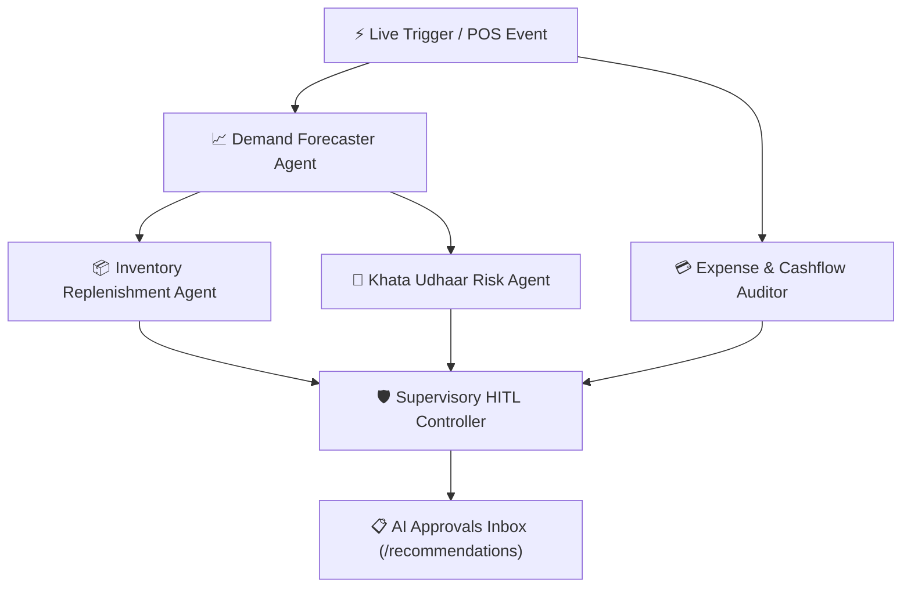

# MicroBizAI - Complete Guide Presentation & Pitch Runbook
## All Demonstration Cases, Sample Inputs, Explanations & 1-Click Reset

> **How to Reset the Database Anytime:**  
> Simply run:  
> ```powershell
> python reset_demo.py
> ```
> *(Or double-click `reset_demo.bat` in the project root)*  
> This wipes the database and immediately re-seeds the exact pristine state with all 80 products, 25 customers, 350+ sales, 16 expenses, 8 purchase orders, and 20 AI recommendations.

---

### Table of Contents
1. [Instant Reset & Setup Instructions](#1-instant-reset--setup-instructions)
2. [Operating Mode Demonstration (`🔒 Manual` vs `⚡ Automation`)](#2-operating-mode-demonstration)
3. [Feature 1: Grocery Inventory & Stock Spectrum (`/products`)](#3-feature-1-grocery-inventory--stock-spectrum)
4. [Feature 2: POS Billing Terminal & Instant Risk Feedback (`/sales`)](#4-feature-2-pos-billing-terminal--instant-risk-feedback)
5. [Feature 3: Khata Customer Debt Ledger & WhatsApp Udhaar Recovery (`/customers`)](#5-feature-3-khata-customer-debt-ledger--whatsapp-udhaar-recovery)
6. [Feature 4: Human-in-the-Loop (HITL) AI Approvals Inbox (`/recommendations`)](#6-feature-4-human-in-the-loop-hitl-ai-approvals-inbox)
7. [Feature 5: Purchase Orders & Supplier Pipeline (`/purchase-orders`)](#7-feature-5-purchase-orders--supplier-pipeline)
8. [Feature 6: Store Expense Manager & Anomaly Detection (`/expenses`)](#8-feature-6-store-expense-manager--anomaly-detection)
9. [Feature 7: Digital Twin Monte Carlo Risk Sandbox (`/simulation`)](#9-feature-7-digital-twin-monte-carlo-risk-sandbox)
10. [Feature 8: LangGraph Multi-Agent Orchestration DAG (`/agent-graph`)](#10-feature-8-langgraph-multi-agent-orchestration-dag)

---

### 1. Instant Reset & Setup Instructions

#### To Start the Application:
```powershell
# Terminal 1: Start FastAPI Backend (Port 8000)
.\venv\Scripts\uvicorn.exe backend.app.main:app --host 127.0.0.1 --port 8000

# Terminal 2: Start Vite Frontend (Port 5173)
npx vite --host 127.0.0.1 --port 5173
```
* Access URL: **http://127.0.0.1:5173**
* Quick Login: Click **`👑 Chetan Gowda`** or **`🏪 Rajesh Sharma`** on the `/register` landing page for instant 1-click access.

#### To Reset Data After Any Demo:
```powershell
python reset_demo.py
```

---

### 2. Operating Mode Demonstration
**Location:** Sticky Top Command Bar & Top of Sidebar  
**Component:** `ZomatoModeToggle` (Sliding Pill Switch)

* **Case 1 &ndash; `🔒 Manual Mode` (Traditional Kirana Control):**
  * *What it is:* A high-density, distraction-free merchant ERP for daily counter operations.
  * *Visible Modules:* Products & Stock, Customer Khata, Sales POS, Purchase Orders, Expense Tracker, Demand Forecasting.
  * *Guide Talking Point:* "When the merchant wants full manual control over daily billing and counter bookkeeping, Manual Mode isolates them from autonomous agent complexity."
* **Case 2 &ndash; `⚡ Automation Mode` (Autonomous Executive Cockpit):**
  * *What it is:* An AI-driven supervisory command center.
  * *Visible Modules:* Autonomous Dashboard, AI Approvals Inbox, LangGraph Agent Workflow, Digital Twin Simulator.
  * *Guide Talking Point:* "In Automation Mode, 5 background AI agents continuously sweep inventory, evaluate credit defaults, audit expense spikes, and formulate 1-click recommendations for the merchant to approve."

---

### 3. Feature 1: Grocery Inventory & Stock Spectrum (`/products`)

Navigate to `/products`. Use the category filter chips or the search bar to demonstrate the following spectrum of cases:

| Case Category | Product Name & SKU | Stock Level vs ROP | Unit Price & Cost | Guide Explanation / Talking Point |
| :--- | :--- | :--- | :--- | :--- |
| **🚨 Critical Stockout Deficit** | **Basmati Rice (50kg Bag)**<br>`GRO-RICE-001` | **Stock: 2**<br>(ROP: 25, Safety: 5) | SP: ₹1,350<br>CP: ₹1,100 | **Only 2 bags left** against weekly demand of 30 units (1.2 days coverage). Breached safety buffer; triggers critical restock alert. |
| **🚨 Daily Perishable Depletion** | **Fresh Dairy Milk (1L Pouch)**<br>`DAIRY-MILK-002` | **Stock: 3**<br>(ROP: 30, Safety: 8) | SP: ₹66<br>CP: ₹58 | High velocity morning milk. Stock of 3 will run out before noon. Demonstrates perishable lead-time intelligence. |
| **⚠️ Low Stock (Below ROP)** | **Aashirvaad Chakki Atta (5kg)**<br>`GRO-ATTA-004` | **Stock: 3**<br>(ROP: 15, Safety: 4) | SP: ₹245<br>CP: ₹215 | Fast-moving core staple below reorder point. Lead time 2 days. Triggers proactive PO recommendation before stockout. |
| **✓ Safe Reserve (Healthy Stock)** | **Chakki Fresh Atta (10kg Pack)**<br>`GRO-ATTA-003` | **Stock: 45**<br>(ROP: 20, Safety: 5) | SP: ₹420<br>CP: ₹360 | Optimal stock health. Green badge, ~4.5 days supply coverage, zero stockout risk. |
| **❌ Negative Margin (Loss Making)** | **Refined White Sugar (50kg Bag)**<br>`GRO-SUG-004` | **Stock: 15**<br>(ROP: 10, Safety: 2) | **SP: ₹2,100**<br>**CP: ₹2,150** | **Negative margin (-2.38%)**. The store loses ₹50 per bag sold! Demonstrates AI pricing auditor recommending markup to ₹2,250. |
| **⚠️ Razor-Thin Margin (+1.5%)** | **Maggi Noodles (Pack 24)**<br>`FMCG-NDL-009` | **Stock: 18**<br>(ROP: 15, Safety: 4) | SP: ₹330<br>CP: ₹325 | Unit profit is only ₹5 (barely covers credit card / POS MDR charges). AI recommends bundle promotion with sauce. |
| **💰 High Margin Champion (+31%)** | **Premium CTC Assam Tea (1kg)**<br>`BEV-TEA-008` | **Stock: 25**<br>(ROP: 10, Safety: 3) | SP: ₹450<br>CP: ₹310 | **Highest margin SKU in store (+31.1%, ₹140 profit/unit)**. AI recommends featuring it at POS checkout counter for upsell. |
| **🧊 Capital Lockup / Dead Stock** | **Parle-G Gold (Carton 48)**<br>`FMCG-BIS-007` | **Stock: 120**<br>(ROP: 20, Safety: 5) | SP: ₹280<br>CP: ₹240 | **60+ days of overstocked inventory locking up ₹28,800 working capital**. AI recommends a 10% clearance promotion. |
| **🌧️ Monsoon Humidity Risk** | **Tata Salt (1kg Pack)**<br>`SPC-SALT-006` | **Stock: 180**<br>(ROP: 50, Safety: 15) | SP: ₹28<br>CP: ₹22 | Overstocked with 120 days coverage. AI advises pausing wholesale reorders to prevent salt clumping in damp weather. |

---

### 4. Feature 2: POS Billing Terminal & Instant Risk Feedback (`/sales`)

Navigate to `/sales`. Use the searchable **ProductCombobox** to demonstrate these test transactions:

#### Test Transaction A: Safe Reserve Everyday Sale
* **Action:**
  1. Click Product Combobox &rarr; Search `"Chakki Fresh Atta"` &rarr; Select `Chakki Fresh Atta (10kg Pack)`
  2. Customer: Select `👤 Walk-in / Cash Customer`
  3. Quantity: `1` | Unit Price: `420`
* **Observed UI Behavior:**
  * Total Bill Amount calculates to **`₹420.00`**.
  * Pre-sale indicator displays: `✓ SAFE RESERVE` (Remaining stock: 45 units).
  * Click **`💳 Complete & Record Sale`** &rarr; Shows success banner with instantaneous inventory reduction to 44 units.

#### Test Transaction B: Critical Deficit Post-Sale Risk Trigger
* **Action:**
  1. Click Product Combobox &rarr; Search `"Basmati Rice"` &rarr; Select `Basmati Rice (50kg Bag) (GRO-RICE-001)`
  2. Customer: Select `Sharma Mess & Catering`
  3. Quantity: `1` | Unit Price: `1350`
* **Observed UI Behavior:**
  * Pre-sale indicator turns to red: `🚨 CRITICAL (STOCKOUT RISK)` (Stock drops from 2 &rarr; 1 unit).
  * Click **`💳 Complete & Record Sale`** &rarr; Generates the **Real-Time Post-Sale Risk Feedback Card**:
    * Highlights: `🚨 CRITICAL RISK: Basmati Rice (50kg Bag)`
    * Metrics: `Remaining Stock: 1 unit` | `Coverage: 0.6 days` | `Reorder Point: 25 units`
    * Action Callout: `Recommended Order Quantity: +28 units` with a direct button to **View Approvals &rarr;**.

#### Test Transaction C: 1-Click "Auto-Fill Sample Sale"
* **Action:** Click the yellow header button **`✨ Auto-Fill Sample Sale`**.
* **Observed UI Behavior:**
  * Automatically detects the lowest-stocked item across all 80 products, pre-populates safe quantity, sets current market price, and demonstrates instant risk calculation.

---

### 5. Feature 3: Khata Customer Debt Ledger & WhatsApp Udhaar Recovery (`/customers`)

Navigate to `/customers`. The table displays 25 customer accounts categorized across all credit aging tiers:

| Customer Name & Contact | Credit Balance | Aging & Overdue Status | Risk Level | Guide Explanation / Action |
| :--- | :--- | :--- | :--- | :--- |
| **Sharma Mess & Catering**<br>`+919811002201` | **₹4,850.00** | **68 Days Overdue**<br>(Limit: 30 days) | 🚨 Chronic Delinquent | Exceeded 30-day statutory limit by 38 days. AI freezes further credit and queues formal 48-hour WhatsApp reminder. |
| **Vikram Singh (Contractor)**<br>`+919811002203` | **₹8,200.00** | **64 Days Overdue** | 🚨 Chronic Delinquent | Large personal contractor credit aging towards default. Triggers UPI payment link dispatch. |
| **Gupta General Stores**<br>`+919811002202` | **₹3,400.00** | **52 Days Overdue** | ⚠️ Severe Overdue | Commercial B2B account overdue. AI halts fresh dispatches until minimum ₹1,500 downpayment is received. |
| **Bawarchi Biryani Centre**<br>`+919811002211` | **₹7,600.00** | **42 Days Overdue** | ⚠️ Overdue Commercial | High volume restaurant account. Dispatches friendly WhatsApp ledger statement with UPI QR code. |
| **Ananya Daily Needs**<br>`+919811002206` | **₹3,200.00** | **4 Days Overdue** | ℹ️ Grace Period Active | Regular family account within 7-day grace window. Generates courtesy notification. |
| **Verma Caterers & Events**<br>`+919811002209` | **₹0.00** | **100% Repaid** | 🟢 VIP Good Standing | Fully cleared invoices on time. Eligible for credit limit expansion from ₹20,000 to ₹30,000. |

* **Interactive Action to Show Guide:** Click on any customer (e.g. `Sharma Mess & Catering`) to open `/customers/:id`, view their itemized invoice payment history, and demonstrate recording an offline partial cash payment.

---

### 6. Feature 4: Human-in-the-Loop (HITL) AI Approvals Inbox (`/recommendations`)

Navigate to `/recommendations`. This page showcases the AI supervisory decision pipeline.

#### Recommendation Demo Cases to Showcase:

1. **Ref #1 &ndash; Critical Replenishment for Basmati Rice (Priority: CRITICAL):**
   * *Telemetry:* On-Hand: 2 units | Depletion: 1.2 days | Recommended Order: +28 units (Est. Cost: ₹30,800).
   * *Action to Show:* Click **`✓ Approve Action`**.
   * *Outcome:* Status updates to **APPROVED**, and the system automatically authorizes Purchase Order #PO-2026-0001 for delivery from Punjab Agro Wholesale!
2. **Ref #6 &ndash; Delinquent Khata Credit Hold for Sharma Mess (Priority: CRITICAL):**
   * *Telemetry:* Overdue: ₹4,850 for 68 days.
   * *Action to Show:* Click **`✏️ Modify Draft`**.
   * *Outcome:* Opens the shopkeeper communication editor. Change text to: *"Dear Sharmaji, please settle ₹4,850 overdue by this evening via UPI."* &rarr; Click **Save Modifications**.
3. **Ref #15 &ndash; Negative Margin Correction for Sugar 50kg (Priority: HIGH):**
   * *Telemetry:* Current retail price ₹2,100 is below wholesale cost ₹2,150 (-2.38% loss margin).
   * *Action to Show:* Explain how the AI detected loss-making sales and recommends price adjustment to ₹2,250 (+4.4% profit).
4. **Ref #12 &ndash; Electricity Bill Anomaly (+53.6% Spike) (Priority: HIGH):**
   * *Telemetry:* Current ₹8,450 vs prior ₹5,500.
   * *Action to Show:* Click **`✕ Dismiss`** to reject autonomous advice (with logged shopkeeper rationale).

---

### 7. Feature 5: Purchase Orders & Supplier Pipeline (`/purchase-orders`)

Navigate to `/purchase-orders`. Demonstrates complete procurement lifecycle:

* **PO Status Pipeline:**
  * `PO-2026-0001` &ndash; **DRAFT** (Generated by AI for Basmati Rice, ₹30,800)
  * `PO-2026-0002` &ndash; **DRAFT** (Fresh Dairy Milk morning order, ₹2,900)
  * `PO-2026-0004` &ndash; **ORDERED** (Nandini Curd with Mother Dairy, ₹1,350)
  * `PO-2026-0006` &ndash; **RECEIVED** (Desi Toor Dal wholesale delivery received, ₹14,200)
  * `PO-2026-0008` &ndash; **PARTIAL** (Surf Excel & Vim Gel consignment partial dispatch, ₹18,500)
* **Interactive Action:** Click on any draft PO to review itemized lines, supplier contact, and authorized status.

---

### 8. Feature 6: Store Expense Manager & Anomaly Detection (`/expenses`)

Navigate to `/expenses`. Demonstrates how MicroBizAI audits fixed vs variable overheads:

* **Key Case Highlights:**
  * **Electricity & Utilities:** Current ₹8,450 vs Prior ₹5,500 (**+53.6% Critical Spike**) &ndash; flags commercial cooler compressor fault.
  * **Freezer Maintenance:** Current ₹3,200 vs Prior ₹1,200 (**+166.7% Emergency Spike**) &ndash; gas recharge.
  * **Digital Marketing:** Current ₹3,500 vs Prior ₹0 (**New Spending Line**) &ndash; flags zero-baseline anomaly.
  * **Rent & Lease:** Current ₹25,000 vs Prior ₹25,000 (**Stable Fixed Cost, 0% Variance**).

---

### 9. Feature 7: Digital Twin Monte Carlo Risk Sandbox (`/simulation`)

Navigate to `/simulation`. Demonstrates probabilistic resilience modeling:

* **Guide Pitch Explanation:**
  > "Instead of guessing whether the store will survive a cash crunch, MicroBizAI runs 10,000 Monte Carlo simulation runs across demand volatility, monsoon supplier delays, and credit defaults."
* **Inputs to Run Live:**
  * Horizon: `30 Days`
  * Number of Runs: `1,000` (Fast) or `10,000` (Comprehensive)
  * Supplier Delay Factor: Set to `1.5x` (Monsoon / Strike condition)
* **Output to Show:**
  * Risk of Cash Depletion Curve (e.g. 0.6% probability).
  * Projected Liquid Reserves at 95% Confidence Interval.
  * Stockout rate distribution across all 80 products.

---

### 10. Feature 8: LangGraph Multi-Agent Orchestration DAG (`/agent-graph`)

Navigate to `/agent-graph`. Visualizes the 5 cooperative AI agents running under the hood:



* **Interactive Action:** Click **`⚡ Trigger Live Store Sweep`** to execute a full graph cycle across all modules in real time!

---

### Summary Checklist for a 10-Minute Guide Evaluation

1. [ ] **Step 1:** Open [http://127.0.0.1:5173/register](http://127.0.0.1:5173/register) &rarr; Click **👑 Chetan Gowda** preset.
2. [ ] **Step 2:** Show the **Sticky Top Command Bar** & flip the **Zomato Dual-Mode Switch** (`🔒 Manual` &harr; `⚡ Automation`).
3. [ ] **Step 3:** Go to **`/products`** &rarr; Search `"Refined White Sugar"` (show **-2.38% loss margin**) & `"Basmati Rice"` (show **critical stock: 2**).
4. [ ] **Step 4:** Go to **`/sales`** &rarr; Use the **ProductCombobox** to search `"atta"`, filter by `🌾 Grains`, and record a sale. Show the real-time risk feedback card.
5. [ ] **Step 5:** Go to **`/customers`** &rarr; Show `Sharma Mess` (**68 days overdue**, chronic delinquent) vs `Verma Caterers` (**₹0 balance**, 100% repaid VIP).
6. [ ] **Step 6:** Go to **`/recommendations`** &rarr; Show 1-click **Approve** (PO pipeline) and 1-click **Modify Draft** (WhatsApp message).
7. [ ] **Step 7:** Go to **`/simulation`** &rarr; Run a 30-day Monte Carlo Digital Twin simulation.
8. [ ] **Step 8:** Reset data afterwards with `python reset_demo.py`!
